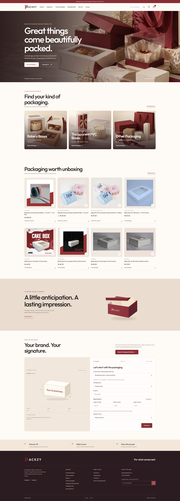
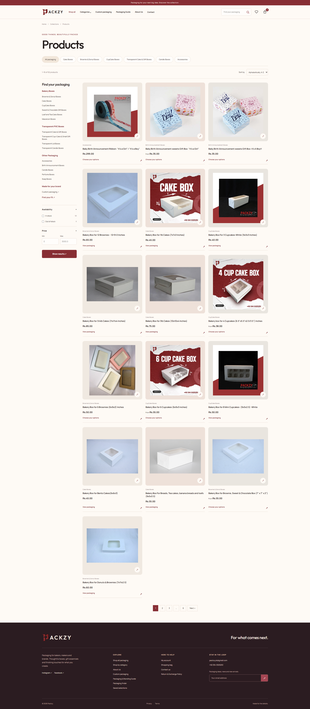
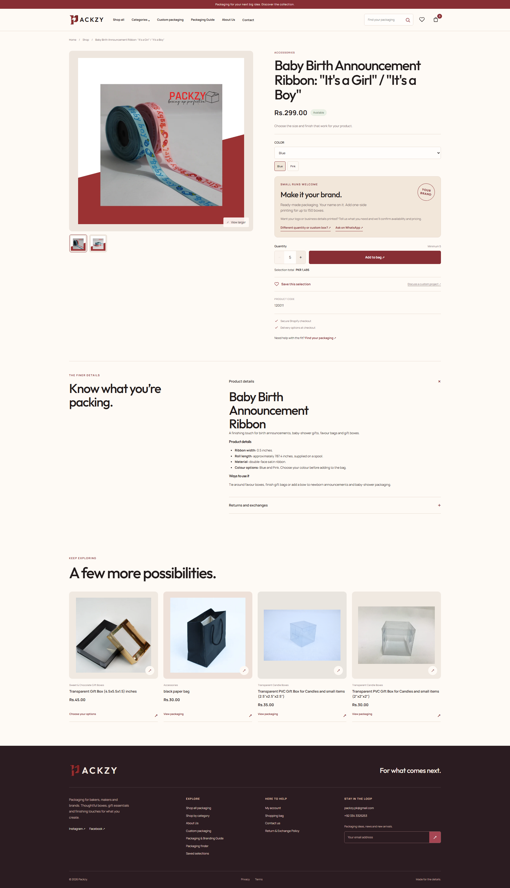
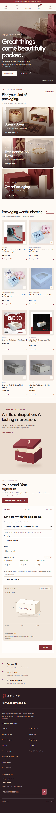

# Packzy — Shopify E-commerce Website

**WordPress to Shopify Migration | Custom Shopify Theme Development | UI/UX Redesign**

A modern e-commerce storefront for packaging products, rebuilt on **Shopify** from an existing **WordPress/WooCommerce** website. The redevelopment focuses on clearer product discovery, a consistent shopping experience, responsive design, and an interactive custom-packaging enquiry workflow.

🌐 **Live website:** [packzy.com.pk](https://packzy.com.pk/)  
👨‍💻 **Developer:** [Muhammad Aliakber](https://github.com/mrajdeveloper)

---

## Project Overview

**Packzy** sells packaging for bakeries, gifting, small businesses, and branded products. The project involved redesigning the storefront and transitioning the online store from WordPress/WooCommerce to Shopify.

The aim was to create a polished, easy-to-navigate shopping experience that works well across desktop, tablet, and mobile devices, while adding helpful tools for customers who need ready-made or custom-branded packaging.

| Project detail | Description |
| --- | --- |
| **Client / Brand** | Packzy |
| **Project type** | E-commerce redevelopment and platform migration |
| **Previous platform** | WordPress + WooCommerce |
| **Current platform** | Shopify |
| **Focus** | Shopify theme customization, responsive UI/UX, product discovery, custom packaging |
| **Status** | Live |

## My Role

I worked on the storefront redevelopment, including:

- Migrating the store experience from WordPress/WooCommerce to Shopify
- Redesigning the website's visual layout and shopping journeys
- Customizing Shopify theme sections and storefront components
- Organizing product collections, categories, and navigation
- Developing responsive layouts for desktop, tablet, and mobile
- Building and refining interactive packaging and branding interfaces
- Improving product presentation, navigation, and accessibility of key actions
- Testing layouts, resolving UI issues, and refining the live storefront

## Project Goals

- Deliver a professional storefront consistent with Packzy's brand identity
- Make packaging products easier to find and compare
- Improve mobile browsing, navigation, and product presentation
- Support custom packaging enquiries with useful dimensions and branding inputs
- Provide a manageable Shopify-based e-commerce foundation

## Key Features

### 1. Custom Shopify Storefront

- Redesigned homepage with branded imagery and product highlights
- Custom collection showcases and product cards
- Clear calls to action and consistent visual styling
- Product detail pages designed for easier browsing

### 2. Collections & Product Discovery

- Organized packaging categories, including bakery boxes, transparent PVC boxes, and other packaging
- Dedicated collection and product browsing experiences
- Desktop category navigation and mobile-friendly menus
- **Packaging finder** with product-type and measurement inputs to help customers explore suitable products
- **Saved packaging selections** for revisiting products in the same browser

### 3. Interactive Custom Packaging & Branding

A custom enquiry flow helps customers communicate their packaging requirements:

- Enter box **length, width, and height**
- Select packaging style, material or finish, and quantity
- Preview the concept using customer-provided measurements
- Select a **print face** (such as front, back, left, or right)
- View a rotating packaging concept for the selected print placement
- Enter an optional **HEX colour code** for brand text
- Preview a logo and provide an artwork link
- Send a custom packaging quotation enquiry

*The visual preview is a concept, not a production-ready proof. Final materials, specifications, pricing, and feasibility are confirmed separately.*

### 4. Responsive Mobile Experience

- Adapted layouts for phones, tablets, and desktops
- Mobile bottom navigation for essential shopping destinations
- Touch-friendly product cards, menus, and actions
- Improved spacing, text readability, and image presentation

### 5. E-commerce Experience

- Shopify-based storefront and shopping bag
- Product options and collection browsing
- Customer account and contact entry points
- Integrated product discovery and custom-packaging enquiry journeys

## Technology Stack

| Area | Technologies |
| --- | --- |
| **E-commerce platform** | Shopify |
| **Theme development** | Shopify Liquid, HTML5, CSS3, JavaScript |
| **Previous store** | WordPress, WooCommerce |
| **Version control / Portfolio** | Git, GitHub |
| **Focus areas** | Responsive development, UI/UX, theme customization, e-commerce |

## Project Screenshots

> **Note:** These image paths refer to the `assets/` folder in this repository. The files should contain screenshots from the **latest Shopify storefront**, not the previous WordPress version.

### Homepage

### Product Collections

### Product Detail Page

### Mobile Experience

## Outcome

Packzy now has a Shopify-based storefront with a cohesive visual identity, responsive browsing experience, organized packaging collections, and a dedicated custom-packaging enquiry process.

The redevelopment brings standard product shopping and made-to-order packaging requirements into a single storefront experience.

## Live Project

**Website:** https://packzy.com.pk/  
**Repository:** https://github.com/mrajdeveloper/packzy

## About This Repository

This public repository is a **portfolio case study** containing project documentation and screenshots. It is **not a distribution of the production Shopify theme or the store's private configuration**.

## Developer

**Muhammad Aliakber**  
Web Developer | WordPress & Shopify | E-commerce Development | Responsive UI/UX

- **GitHub:** https://github.com/mrajdeveloper
- **Live project:** https://packzy.com.pk/

---

*Packzy brand assets and product imagery belong to their respective owners. This repository is presented to demonstrate my web-development work.*
